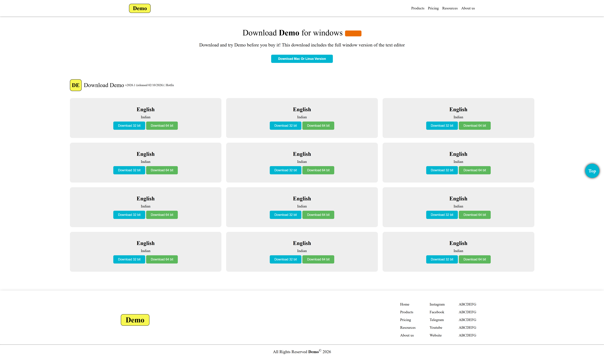

# Front-End-Project Preview :
<!--  -->
<h2>Front-End-Project Preview</h2>


# Demo Download Page

A simple frontend project inspired by a software download page. The design has a clean layout with a navigation bar, a download introduction, a grid of download cards, and a footer with useful links.

I built this project to practise structuring a webpage with HTML and styling it with CSS. The focus is on matching the layout, spacing, colours, and card-based design shown in the reference.

## Preview

The page includes:
- A top navigation bar with the Demo logo and menu links
- A main heading and short description introducing the download
- A button for the Mac or Linux version
- A grid of language and download cards, each with 32-bit and 64-bit buttons
- A footer with navigation and social links
- A floating “Top” button for returning to the top of the page

> **Note:** The download buttons and navigation links are currently part of the frontend layout. They need real download URLs or page links to work as a complete download website.

## Built With

- HTML5
- CSS3

## Project Structure

```text
Front-End-Project-1/
├── index.html
├── style.css
├── Screenshots/
│   └── Front-End-Project-1.png
└── README.md
```

## Run Locally

No package installation or build tools are required.

1. Clone this repository:

   ```bash
   git clone https://github.com/gohel-chirag/Front-End-Project-1.git
   ```

2. Open the project folder:

   ```bash
   cd Front-End-Project-1
   ```

3. Open `index.html` in your browser.

You can also open the folder in VS Code and use the Live Server extension while making changes.

## What I Practised

- Building a webpage with semantic HTML
- Styling navigation, buttons, cards, and footer sections with CSS
- Using a grid layout to organise repeated download cards
- Keeping styles in a separate stylesheet
- Recreating a page layout from a visual reference

## Possible Improvements

- Connect the download buttons to actual files or download URLs
- Replace placeholder navigation links with working destinations
- Check and refine the layout across mobile, tablet, and desktop screen sizes
- Improve keyboard navigation and accessibility
- Add a real screenshot of the project to this README

## Feedback

Suggestions and feedback are welcome. Feel free to open an issue or share an improvement.

---

Made as a frontend practice project.
